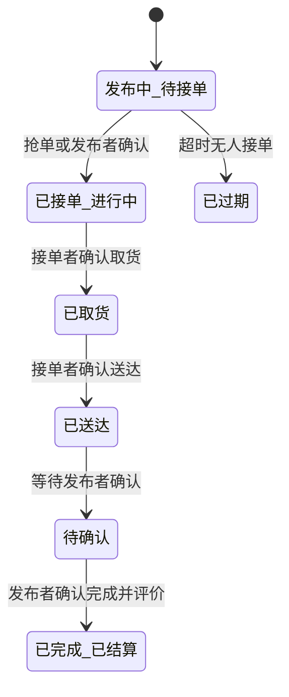

# 需求文档评估报告

## 结论（给 PM）

- **判断**：需求文档是合格的梳理稿（覆盖面好、页面描述清晰），但**不建议直接开工**。
- **卡点**：① 校园网/校园卡第三方对接方案空白（工作量最难预估）；② 资金合规方案缺失（人民币归集/提现是法律底线）；③ UGC 内容审核缺失（影响所有发布模块，不过审无法上架）。
- **需要你确认**：P0 问题清单（§3.1）逐条定责任人与解决时间，尤其对接方案与合规两条。

| 项         | 内容                                                                                                                              |
| ---------- | --------------------------------------------------------------------------------------------------------------------------------- |
| 评估对象   | [`../../需求文档.md`](../../需求文档.md)（校园圈 APP 需求文档 1.0）                                                                 |
| 快照日期   | 2026-10-13（源文档末尾自述仍在演进："其他修改完善内容随后我晚点弄完再发"，结论仅对该快照负责）                                       |
| 辅助材料   | [`../../origin/校乐趣0825/`](../../origin/校乐趣0825/) 设计稿 80 张；[`../../origin/需求文档.docx`](../../origin/需求文档.docx) 原件                    |
| 评估结论   | **需求梳理稿**：覆盖面广、页面级描述清晰，但存在多处硬矛盾与系统性缺失，**不建议直接进入开发**                                       |
| 报告状态   | active（源文档修订后需复核本报告并刷新 `updated`）                                                                                 |

## 一、总体结论

**当前状态：需求梳理稿（1.0 初稿），覆盖面广但不足以直接进入开发。**

- ✅ **覆盖面好**：17 章、约 80 张设计稿对应、5 个主 Tab 全链路均有涉及，页面级描述（从上到下拆区域）清晰可用
- ⚠️ **存在多处硬矛盾**：命名不统一、同一规则前后不一致，其中数处会直接阻塞开发
- 🔴 **系统性缺失**：账号体系、内容安全审核、隐私合规、非功能性需求完全空白——这些不是"细节"，是国内 App 上架与运营的**门槛**

三个最重大风险（详见第六章）：

1. 🔴 **校园网/校园卡第三方系统对接方案空白**——核心"刚需入口"的数据来源未知，工作量最难预估
2. 🔴 **资金合规方案缺失**——平台涉及人民币归集与提现，属法律底线，必须在编码前决策
3. 🔴 **UGC 内容审核缺失**——影响所有发布类模块的交互设计，不过审核无法上架

## 二、文档优点（值得保留的写法）

| 优点             | 说明                                                             |
| ---------------- | ---------------------------------------------------------------- |
| 页面结构描述法   | 每章按"从上到下"拆区域，UI 还原工作量小                            |
| 角色差异化意识   | 校园网用户 vs 访客（3.2 身份、3.6 活动定价），有商业化思考        |
| 字段表格化       | 发布类表单带必填/字数/数量限制，可直接用于验收                   |
| 后台配置同步收集 | 第十六章把运营后台一起收了，上线后运营数据有监控                       |
| 待定问题清单     | 第十七章主动留口子，且文档末尾已逐条回答（核对结果见第四章）      |

## 三、问题清单

### 3.1 🔴 P0 阻塞级：开工前必须解决，否则必然返工

| #   | 问题                       | 位置        | 说明                                                                                                                                                             |
| --- | -------------------------- | ----------- | ---------------------------------------------------------------------------------------------------------------------------------------------------------------- |
| 1   | **技术形态未定义**         | 全文        | 标题是"APP"，但 3.6 出现"或 H5 链接？"。原生 / Flutter / RN / 小程序直接决定工作量、团队与全部排期                                                                 |
| 2   | **校园网/校园卡对接空白**  | 3.3         | 核心价值是"刚需入口"，但卡状态（欠费/密码绑定错误）、上下线、Hnny-WiFi 认证全靠外部系统（RADIUS/portal/计费系统）。数据从哪来、接口谁提供、账号是否打通——全文零描述，工作量最难预估 |
| 3   | **资金合规方案缺失**       | 5.5/14.3/16.4 | 平台涉及人民币归集（跑腿报酬预付、商品款、提现到微信/支付宝/银行卡）。是否持牌、是否二清、结算周期/手续费/提现门槛/退款规则均未定义。法律底线，非产品细节 |
| 4   | **账号体系缺失**           | 全文        | 有设计稿（注册、账号密码登录、忘记密码）但需求正文完全没有登录/注册/找回/第三方登录/Token 章节                                                                     |
| 5   | **UGC 内容审核缺失**       | 六/七/十一  | 社区、表白墙、二手、跑腿全是 UGC。先发后审还是先审后发？敏感词/鉴黄/举报处理流程（16.4 只有"投诉管理"）？国内 UGC 平台不过审核无法上架                            |

### 3.2 🟡 P1 重要：规则不完整或存在合规风险

| #   | 问题                          | 位置          | 说明                                                                                                                                                           |
| --- | ----------------------------- | ------------- | -------------------------------------------------------------------------------------------------------------------------------------------------------------- |
| 6   | 跑腿报酬模式三处不一致        | 5.5/11.4/4.5  | 5.5 写"支持人民币模式"，11.4 写"碎银/人民币双模式"，4.5 又说碎银可"抵扣发布跑腿任务"。三处说法不一，直接影响支付与结算系统设计                                  |
| 7   | 接单模式矛盾                  | 5.5/11.5      | 5.5"多人申请→发布者手动确认"，11.5 按钮是「抢单」。抢单是先到先得，与申请-确认是两种产品形态，需二选一                                                          |
| 8   | 跑腿状态机不完整              | 11.2/11.6     | 流转图没有"已取货""已送达"节点，但 11.6 操作表全按这两个状态出按钮；"已过期"是否自动退款（报酬已预付）未定义。详见第五章                                          |
| 9   | 碎银经济系统无风控            | 四/十六       | 碎银可换实物/网费/餐饮，获取渠道含刷广告、邀请好友、学长赠送。无每日上限、无反刷单规则、无发行-消耗监控报表（16 章后台只有内容管理，无数据报表）。通胀和恶意刷取必然发生 |
| 10  | 盲盒合规                      | 4.3           | 有"奖品清单"但无中奖概率、无保底规则。《盲盒经营行为规范指引》要求公示概率                                                                                       |
| 11  | 隐私合规                      | 5.2/5.5/十二  | 联系方式脱敏、手机尾号仅接单员可见——方向对；但隐私政策、用户协议、数据收集告知、注销账号、流量排行榜是否可关闭，全部未提                                        |
| 12  | 多校区/多校部署范围未定       | 3.2/5.2/11.3  | "河南某某职业大学"+多校区切换。单校部署还是多校 SaaS？影响账号体系（学号唯一性）与数据隔离                                                                      |
| 13  | "商户客服/在线聊天"孤儿需求   | 10.4          | 未定义商户角色、未定义 IM 页面（发送订单/商品/跑腿卡片），突然出现无上下文                                                                                       |
| 14  | 流量指标定义不清              | 3.3/十二      | "已产生流量 639.20GB"与排行榜"流量使用量"是否同一指标？统计周期（出账期按月 vs 排行每日更新）不统一；且公开排名可能诱导刷流量                                     |

### 3.3 🟢 P2 一般：命名不一致与文案问题（术语表可一次性解决）

| #   | 问题                            | 位置             | 说明                                                                                           |
| --- | ------------------------------- | ---------------- | ---------------------------------------------------------------------------------------------- |
| 15  | **Tab 名称混用**                | 全文             | 第二章定义 Tab 叫"校友圈"，但 6.1/7.1/10.1/11.1/11.5 五处写"社区Tab"                            |
| 16  | 金刚区标题与表格矛盾            | 3.5              | 标题"4行×3列，共12个"，表格实际 3 行 × 4 列（表头有"第四列"）                                   |
| 17  | 跑腿入口名称不一                | 3.5/11.1/11.5   | 「校内跑腿」「校内任务」混用；3.5 末句"「校内任务」改为跑腿任务入口"说的名字在表格里根本不存在   |
| 18  | 社区分类两版                    | 6.1/6.3/5.4      | 6.1 有"短视频"，6.3 完整列表是"作品"，发布类型（5.4）只有"作品"                                 |
| 19  | 二手/跳蚤术语四版               | 3.5/4.3/5.1/5.2/6.3 | 跳蚤 / 闲置 / 二手 / 二手市场混用                                                          |
| 20  | 校友圈层级套娃                  | 六/九            | 校友圈既是顶级 Tab、又是分类、又有独立页面，且 9.2 里还有"关注/表白墙"二级 Tab；表白墙入口同时挂在金刚区、社区分类、校友圈页面三处，层级关系需梳理 |
| 21  | 14.5 标题"3个卡片"实列 4 个     | 14.5             | 多了"我的报名"                                                                                 |
| 22  | 错别字/病句                     | 多处             | "已生产流量"应为"已产生"（3.3）；"跑腿内务配送"（4.8）；"无助问答"（设计稿文件名，正文是互助问答）；"兑换校园网、校园网"重复（4.5）；"碎银有效订单60天"语义不明（文档末尾，疑似"碎银有效期60天"）；14.4"（二手商品、商品、、跑腿）"多顿号 |
| 23  | 订单页双筛选维度未说明 UI       | 15.1/15.3/14.4  | 状态 Tab（全部/待付款/进行中…）+ 分类 Tab（全部/商品/服务/兑换/充值）并存，同屏如何摆放未定义；14.4 里"商品"和"二手商品"并列，区别不明 |
| 24  | 设计稿与正文未对应            | 全文             | 地址簿、收货信息、设置、最佳答案、问答详情、登录注册有设计稿但正文无对应章节，需统一             |

## 四、第十七章「待定问题」核对

文档末尾已逐条回答，核对结果：

| # | 问题             | 回答                                                           | 核对结果                                                                                       |
| - | ---------------- | -------------------------------------------------------------- | ---------------------------------------------------------------------------------------------- |
| 1 | 升级套餐指什么   | 校园网/校园卡套餐升级                                          | ✅ 已明确；建议同步更新 4.1/4.5 正文并删掉 ❓                                                  |
| 2 | 校园活动定价     | 免费用户碎银部分抵扣+较多人民币补；持卡用户碎银全抵            | ✅ 已明确；但**抵扣比例/"较多"的量化规则仍未定义**，且需补小号刷碎银占付费活动便宜的风控           |
| 3 | "更多内容"跳转   | "碎银可用来干什么一览表"海报页                                 | ✅ 已明确                                                                                      |
| 4 | 碎银有效期       | "我的规则，碎银有效订单60天"                                   | ⚠️ **语义有歧义**，疑为"碎银有效期 60 天"；需说明与 4.5"流量按月清零"的关系及 15.2"本月到期碎银"字段算法 |

## 五、跑腿状态机缺口分析

文档 11.2 声明的流转与 11.6 页面实际所需状态对不上，缺口如下：

- 11.2 文本流转：发布中 → 已接单 → 待确认 → 已完成 ↓ 已过期，**缺少"已取货""已送达"两个中间态**
- 11.6 操作按钮表按"跑腿已取货/跑腿已送达/已接单待取货/已取货待送达"出按钮，依赖上述缺失状态
- 未定义项：「已过期」是否终态、报酬已预付时的自动退款流程、退款时效

## 六、风险登记与工作量粗估

### 6.1 风险登记（按程度）

| 级别 | 风险                                   | 应对                                                     |
| ---- | -------------------------------------- | -------------------------------------------------------- |
| 🔴   | 校园网/校园卡第三方系统对接进度取决于校方/运营商 | 第一周即向校方/运营商确认接口文档与账号打通方案          |
| 🔴   | 资金合规（人民币归集/提现/二清）        | 编码前确定持牌或合规通道方案；决定整体支付架构          |
| 🔴   | 内容审核（UGC 不过审无法上架）          | 确定先审后发或先发后审；影响发布流程与消息推送设计      |
| 🟡   | 技术形态未定                           | 尽早决策（建议 Flutter 双端 + 后台 Web）                 |
| 🟡   | 碎银经济系统通胀与恶意刷取              | 补风控规则 + 后台发行/消耗监控报表                       |
| 🟡   | 隐私合规（个人信息保护法）              | 补隐私政策、用户协议、注销账号流程                       |
| 🟢   | 命名/文案不一致                        | 做一张术语表（见附录 A）一次性解决                     |

### 6.2 工作量量级判断

> 假设：Flutter 双端 + 管理后台 Web + 后端。工作量量级为工程经验判断，仅供相对比较；具体工期以[排期与里程碑计划](../PM/排期与里程碑计划-给PM.md)为准（按团队实际投入档测算）。

| 模块 | 量级 |
| --- | --- |
| 账号/登录/学生认证 | 中 |
| 首页 + 校园卡/网管理 + 外部对接 | **高（外部对接占大头）** |
| 碎银商城（商品/分类/详情/兑换/盲盒） | 中 |
| 社区/校友圈/信息流/多级评论 | 中 |
| 发布（4 类表单） | 中 |
| 跑腿系统（状态机/IM/结算） | 高 |
| 消息系统 + IM | 中 |
| 流量排行/封面涂鸦 | 低 |
| 我的/订单/提现 | 中 |
| 后台运营 + 数据报表 | 中 |
| 支付/风控/审核基建 | 高 |

**MVP 可砍项**：作品/打赏、盲盒、互助问答、封面涂鸦、短视频——均为独立模块，裁掉不伤主链路。

## 七、建议的下一步（按优先级）

1. **本周内决策**：技术形态、MVP 范围（建议裁掉 6.2 列出的 5 项）、单校/多校部署
2. **启动三项外部确认**：校方校园网系统接口、支付渠道与合规方案、内容审核方案（自建或第三方）
3. **补三个全局章节**：账号体系、内容安全与审核、数据埋点/统计规范；另补一节"非功能性需求"（性能、兼容性、安全）
4. **做术语表**：一次性统一 Tab 名（社区→校友圈）、二手三态、跑腿入口名、作品/短视频（草案见附录 A）
5. **修正 3 处硬矛盾**：金刚区标题（3.5）、跑腿报酬模式（5.5/11.4）、接单模式（5.5/11.5）
6. **补后台数据报表需求**（DAU、转化漏斗、碎银发行/消耗监控）——积分体系没有监控等于蒙眼开车

## 八、遗留事项与未验证假设

**遗留事项**

- 仓库根存在 `.~lock.需求文档.docx#`，表明 docx 原件正被编辑，md 稿与 docx 可能存在版本漂移，定稿前需确认以哪份为准
- 源文档修订后，本报告需复核并刷新 frontmatter `updated`
- 80 张设计稿未逐张与正文比对，仅按文件名与章节覆盖度比对（地址簿、收货信息、设置、问答类设计稿无正文对应）

**未验证假设**

- 工作量估算为经验值粗估，未基于任何团队速率校准
- "Flutter 双端 + 后台 Web"为建议而非既定决策
- 假设校方存在可对接的校园网认证/计费接口（RADIUS/portal）——未与校方确认
- 假设存在可用的人民币收款合规通道——未与支付渠道确认

## 附录 A：术语表草案

| 概念       | 建议统一术语 | 当前混用                        | 涉及位置            |
| ---------- | ------------ | ------------------------------- | ------------------- |
| 社交主 Tab | 校友圈       | 社区Tab / 校友圈                | 二/六/九/十/十一    |
| 二手交易   | 校内跳蚤（或"二手"，二选一） | 跳蚤 / 闲置 / 二手 / 二手市场 | 3.5/4.3/5.1/5.2/6.3 |
| 跑腿入口   | 校内跑腿     | 校内任务 / 校内跑腿             | 3.5/11.1/11.5       |
| UGC 作品   | 作品         | 作品 / 短视频                   | 5.4/6.1/6.3         |
| 问答板块   | 互助问答     | 互助问答 / 无助问答（设计稿文件名） | 5.3/6.3          |
| 流量术语   | 已产生流量   | 已生产流量                      | 3.3/四/十二         |
